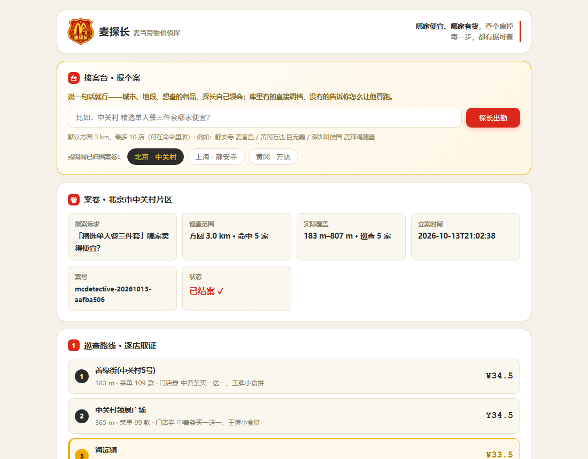
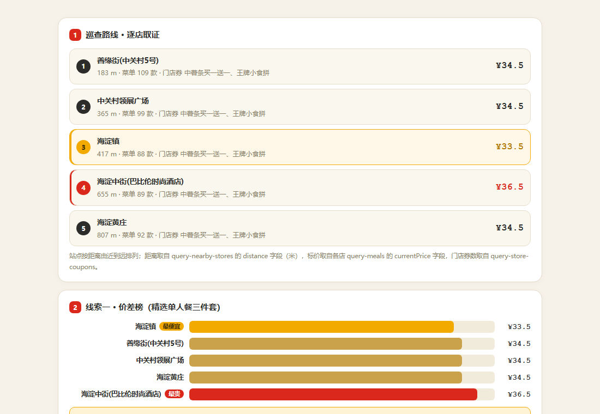
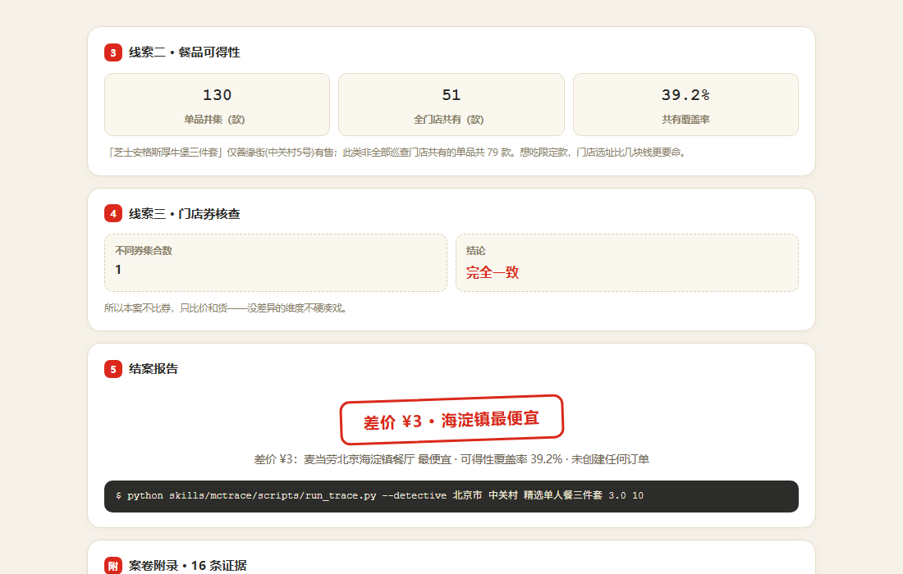
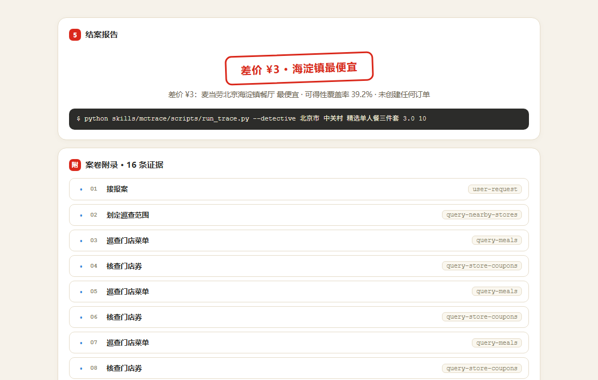
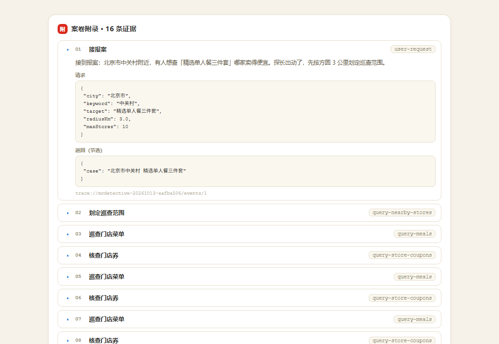

# McTrace · 麦搭子 —— 把它怎么给你挑的，全程摊开给你看

<p align="center"></p>
<p align="center"><b>麦探长</b>（本仓库门面场景）· 麦当劳物价侦探 —— 跑遍方圆几公里的门店，把「哪家便宜、哪家有货」查个底掉，每条线索都可戳开核验。</p>
<p align="center"><b>👉 在线试用（无需安装）：<a href="https://mcdetective.app.workbuddy.host/">https://mcdetective.app.workbuddy.host/</a></b>　|　仓库：<a href="https://github.com/StrawberryTreea/mcdetective">github.com/StrawberryTreea/mcdetective</a>（觉得探长称职，点个 Star ⭐）</p>

> 麦搭子，是你的 AI 点单搭子：你吩咐一句，它不闷头扔结果，而是把「怎么给你挑的」当场演出来——边做边说、会亮红灯、还会老实认怂。
> 点单也好、盘积分也好，每一步都锚在真实麦当劳 MCP 调用上，点得开、看得见原始数据：过程全摊开，能随时戳、能挑刺。

**McTrace 是一个真实产品**（以 WorkBuddy Skill 形态交付）：用户用自然语言说一句需求，模型就**自主配置连接器、自主运行、自主把结果呈现出来**。本次参赛只是它的公开亮相与拿奖励的载体。

---

## 看得见的办案过程（真实运行截图 / 动图）

下面是麦探长办北京中关村那宗案子的全过程，全部为**对麦当劳 MCP 的真实只读调用**（案号 `mcdetective-20261013-aafba506`，2026-10-13）。

**办案直播（Live Story 回放，16 条证据逐条长出）**


**① 接案台 —— 你说一句话，他自己领会**



**② 巡查路线 · 逐店取证 → 线索一 · 价差榜**



**③ 线索二 · 餐品可得性（128 款并集，家家都有的只有 39%）**



**④ 结案报告 —— 差价 ¥3，海淀镇最便宜；一条命令可复现**



**⑤ 案卷附录 —— 每条证据可展开原始请求与返回**



> 想自己动手：打开 [在线试用](https://mcdetective.app.workbuddy.host/)，在接案台里报个案（比如「静安寺 麦香鱼」「黄冈万达 巨无霸」），或按下方「快速开始」本地跑一次。

---

## 它特别在哪

别家 AI 帮你办事，只给你一个结果；McTrace 把「它怎么办的」全程摊开给你看：

- **边做边播**：查门店、翻菜单、核热量、算价，事件一条条实时「边长」，像看直播而不是等宣判。
- **随手戳**：任意一家店、一份餐、一张券、一个价格，点开就能看它从哪个真实接口来、原始返回长啥样——像发弹幕一样随时验真、挑刺。
- **会认怂**：算价接口没返明细？它直接说「按菜单价给你，不瞎编」；餐品超了你 500 千卡的线？它自己亮红灯跳过。一个不装、老实的搭子，比「可信」俩字招人喜欢。

俏皮腔可以很欢，但每一句都锚在一次真实麦当劳 MCP 调用上，点得开、看得见原始数据——这是它和「编故事的 AI」最不一样的底子。

---

## 它长什么样

一份 McTrace Trace 由一串**事件**组成，每个事件都带：

| 字段 | 含义 |
| --- | --- |
| `title` / `tool` | 这一步在做什么（中文标题 + 真实工具名）|
| `facts[]` | 从返回里抽出的**事实**，每条标注 `sourcePath`（如 `$.data[0].storeName`）|
| `entities{}` | 可点击实体（门店 / 餐品 / 券 / 金额）及其角色 |
| `rule` | 触发的约束校验结果（预算、热量）|
| `say{friendly, pro}` | 同一事实的**双视角叙述**：俏皮版 / 专业版 |
| `request` / `response` | 原始调用与返回（证据，可展开核对）|
| `evidenceRef` | 该事件的证据地址（`trace://…/events/{seq}`）|

`apps/studio/live_story.html` 是一个**离线可回放**的可视化界面：顶部下拉可切换多个真实场景，流式播放事件、点击任意实体或来源路径打开「证据透镜」查看原始 request/response、并在结尾给出结果卡。

**内置两个真实场景**（同一套 Trace schema）：

| # | 场景 | 只读链路 | 看点 |
| --- | --- | --- | --- |
| ① | 静安寺早餐 · 点餐推荐 | 门店 → 菜单 → 营养 → 券 → 算价 | 热量超标 `warning` + 算价**诚实降级** |
| ② | 积分资产盘点（原「麦麦资产管家」） | 账户 → 抽奖 → 奖品 → 订单 → 满意度奖券 → 积分商城 → 券/活动 | 历史已过期积分**资产流失告警** + 最值兑换 |

下面是仓库内一份**真实运行**的 Trace（场景①，静安寺早餐，非模拟）：

```
• [user-request]        先把要求记下来     → 预算 ¥40 / 热量 ≤500kcal / 有券就用
• [query-nearby-stores] 找到具体门店       → 麦当劳上海静安寺餐厅（storeCode 1450002）
• [query-meals]         认真翻了菜单       → 117 个带价单品
• [list-nutrition-foods] 核对候选热量       → 匹配 12 个正餐单体热量
⚠ [mctrace:rule]         发现约束冲突       → 「培根安格斯厚牛堡」707kcal，超上限 207
• [query-store-coupons] 查看门店券         → 麦旋风任选 / 薯薯任选（本单不适用）
⚠ [calculate-price]     核算价格           → 算价未返回明细 → 诚实降级用菜单标价 ¥23
✓ [summary-composer]    整理好结果与证据    → 推荐「麦香鱼」¥23 / 325kcal · 未下单
```

## 架构

```
MCP Adapter + Trace  →  Event Normalizer  →  Fact & Rule Engine  →  Narrative Engine  →  Live Story UI
   (真实调用捕获)          (事实归一化)          (预算/热量约束)        (俏皮/专业双文案)      (可回放 + 证据透镜)
        │                                                                                      │
        └──────────────────────►  Trace Store (旁路)  ─────────────────────────────────────────┘
                                        │
                              Evidence Explorer · Summary Composer
```

对应到本仓库：

| 蓝图分层 | 代码 |
| --- | --- |
| MCP Adapter + Trace | `packages/core/mcp_client.py` |
| Fact & Rule / Narrative（点餐场景） | `packages/core/pipeline.py` |
| Fact & Rule / Narrative（积分盘点场景） | `packages/core/pipeline_points.py` |
| 旁路探针（原始响应留存） | `packages/core/probe_scenario.py` |
| Live Story UI + Evidence Lens（渲染内核） | `packages/studio_core.py` —— App 与 Studio **共用同一份** |
| 交付形态①：对话内 MCP App | `packages/mcp_app/server.py` + `packages/mcp_app/build_app.py` |
| 交付形态②：独立 Studio（后备 / 深度分析） | `apps/studio/live_story.html`（由 `apps/studio/build_studio.py` 生成）|
| 真实 Trace 样本 | `examples/traces/*.json` |
| Pages 落地页 | `docs/index.html` |

> 两种交付形态共用同一份 Trace 结构与渲染内核：
> **MCP App** 走 MCP Apps（SEP-1865）把界面渲染进对话；**独立 Studio** 是自包含 HTML，
> 在宿主不支持界面时兜底，也承担离线查看 / 载入任意 trace / 深度分析的入口。

---

## 快速开始

> 纯 Python 标准库，**无需安装任何依赖**。

### 0. 装进 WorkBuddy（推荐 · 用户只说一句话）

```bash
python skills/mctrace/scripts/install.py           # 安装 / 升级（幂等，可反复执行）
python skills/mctrace/scripts/install.py --check   # 查看安装状态
python skills/mctrace/scripts/install.py --uninstall  # 卸载（移入 ~/.workbuddy/trash/，不硬删）
```

安装器把产品放进两处，互不影响：

| 位置 | 内容 |
| --- | --- |
| `~/.workbuddy/apps/mctrace/` | **运行时**：`packages/core`（流水线）、`packages/mcp_app`（App 服务器）、`apps/studio`（回放生成器）、`examples/traces`（Trace 产物）、`VERSION` |
| `~/.workbuddy/skills/mctrace/` | **智能体入口**：`SKILL.md`、`scripts/`、`references/` |
| `~/.workbuddy/mcp.json` | **连接器**：`mctrace-app`（应用本体，stdio）+ `mcd-mcp`（数据通道，含你的 Token） |

### 1. 让界面直接出现在对话里（MCP App · 首选形态）

装好后， McTrace 自带一个 MCP 服务器，遵循 **MCP Apps（SEP-1865，2026-01-26 稳定版）**：
工具挂 `_meta.ui.resourceUri`，服务器提供 `ui://mctrace/live-story` 资源
（mimeType `text/html;profile=mcp-app`），宿主把它渲染进对话里——**用户不用跳转，不用打开文件**。

注册连接器（幂等，数据通道需要一次 Token）：

```bash
python ~/.workbuddy/skills/mctrace/scripts/configure_connector.py --check
python ~/.workbuddy/skills/mctrace/scripts/configure_connector.py --token-file <Token文件>
python ~/.workbuddy/skills/mctrace/scripts/configure_connector.py --server mctrace   # 只要 mcd-mcp 的 Token 已就绪，可只补应用本体
```

重启 WorkBuddy 后，对话里会多出带界面的工具：

| 工具 | 作用 | 参数 |
| --- | --- | --- |
| **`mctrace_start`** | **首选**：立即返回 traceId 并渲染界面，后台真实调用，事件一条条往上长 | `scenario=order\|points`，`keyword` / `budget_yuan` / `max_kcal` / `city` |
| `mctrace_scan_order` | 点餐推荐，一次把整条轨迹给全（不等轮询） | `keyword` / `budget_yuan` / `max_kcal` / `city` |
| `mctrace_scan_points` | 积分资产盘点 | — |
| `mctrace_get_summary` | 取某次追踪的文本结论（无界面宿主的兜底） | `traceId` |
| `mctrace_open_studio` | 返回独立 Studio 回放页路径（深度分析入口） | — |

**实时是怎么做到的**：`mctrace_start` 不等任务跑完（实测 0.01 秒返回，此时事件数为 0），
后台线程再依次调麦当劳 MCP，每产生一条事件就写进 `TraceStore`；
界面每隔约 900ms 读一次 `mctrace://runs/{traceId}` 快照，按 `seq` 增量追加、自动去重。
后台跑完 → `status=completed` → 停轮询、固定结果卡。

服务器侧协议是否都对，可以自检（44 项断言，不需要联网）：

```bash
python packages/mcp_app/selftest.py            # 离线样本
python packages/mcp_app/selftest.py --live     # 真实调用麦当劳 MCP
```

**界面在浏览器里真的会边长吗？** 可以自己看 —— 下面这个页面把「模拟宿主 + 界面 + 一份真实 trace」
打成一个文件，双击就能播放全过程：

```bash
python packages/mcp_app/build_app.py --live-demo examples/traces/real-jingan-breakfast.json
# → docs/app-live-demo.html
```

向后兼容：工具**一定同时返回可读文本**，命令行等无界面的宿主照样能拿到结论；
界面轮询失败 3 次会停下并提示，不会空转。
宿主兼容性到底验证到哪一步（哪些是实测、哪些还没验），全部写在 `docs/compatibility.md`，不假装。

### 2. 独立 Studio 回放页（兼容后备 · 深度分析入口）

自包含 HTML，双击即开，**离线可用**，支持场景切换、播放控制、载入任意 `trace.json`：

```bash
python apps/studio/build_studio.py
python ~/.workbuddy/skills/mctrace/scripts/run_trace.py --all   # 跑真实链路 + 生成回放页
```

### 3. 配置麦当劳 MCP（拿一个 Token）

方式 A（推荐，命令行）：

```bash
python ~/.workbuddy/skills/mctrace/scripts/configure_connector.py --check
python ~/.workbuddy/skills/mctrace/scripts/configure_connector.py --token <你的Token>
python ~/.workbuddy/skills/mctrace/scripts/configure_connector.py --token-file <文件>  # 避免 Token 出现在命令行历史
```

方式 B（图形界面）：WorkBuddy【专家·技能·连接器】→【连接器】→【自定义连接器】→【配置 MCP】，
填入 `mcp-config.example.json` 的内容，把 `Authorization` 换成你自己的 Token（在麦当劳 MCP 控制台申请）。

### 4. 跑一次真实场景 → 生成 Trace（直接的用法）

**场景① 点餐推荐**（静安寺附近、预算 ≤40 元、热量 ≤500kcal、有券就用）

```bash
python packages/core/pipeline.py https://mcp.mcd.cn 静安寺 40 500 上海市
```

**场景② 积分资产盘点**

```bash
python packages/core/pipeline_points.py https://mcp.mcd.cn
```

脚本会串联对应的**只读**工具，输出 `examples/traces/real-jingan-breakfast.json` / `real-points-steward.json`
（固定场景名，重复运行覆盖，不会堆积），并在控制台打印俏皮叙事。

装成本地 Skill 后，推荐直接用入口脚本一次跑完（自动定位运行时目录，无需手动切路径）：

```bash
python ~/.workbuddy/skills/mctrace/scripts/run_trace.py 静安寺 40 500 上海市  # 场景①
python ~/.workbuddy/skills/mctrace/scripts/run_trace.py --points              # 场景②
python ~/.workbuddy/skills/mctrace/scripts/run_trace.py --all                 # 两个都跑
```
Token 请放在环境变量或本地文件读取，**不要写进仓库**。

> Token 读取优先级：环境变量 `MCD_TOKEN` > 环境变量 `MCD_TOKEN_FILE` 指定的文件 > 仓库根 `token.txt`（已 gitignore）。
> `pipeline.py` 把目标 URL 作为命令行参数传入，方便在受限网络环境或沙箱中显式声明目标主机。

### 5. 生成可视化回放页（离线可开）

```bash
python apps/studio/build_studio.py
# 产出 apps/studio/live_story.html 与 docs/index.html（自包含、双击即开）
```

打开 `live_story.html`：点「▶ 播放」流式回放，点任意**实体芯片**或**来源路径**打开证据透镜，
右上角可切换「俏皮 / 专业」双视角，也可「📂 载入」你自己的 trace.json。

---

## 直接看结果

不想跑代码？仓库里已内置两份真实 Trace：

- 打开 `apps/studio/live_story.html`（已内联两个场景，双击即回放），顶部下拉切换。
- Trace 原始文件：`examples/traces/real-jingan-breakfast.json`、`examples/traces/real-points-steward.json`

---

## 设计原则（不是口号，写进了代码）

1. **只叙述已观察到的事实**：不在返回数据之外补全名称（例如不在营养表里的餐品不会被编造热量）。
2. **金额以真实标价为准，算价失败就降级**：`calculate-price` 未返回明细时，显式标注 `priceSource=menu`，而不是假装算价成功。
3. **约束真的会被执行**：预算与热量是硬校验，不满足就发 `warning` 事件。
4. **拟人化 ≠ 编造思考**：俏皮文案只描述已发生的事实（"我翻了菜单"，而不是"我心想这家店老板今天心情不错"）。
5. **全程只读**：本项目只调用查询类工具，**绝不**触发下单 / 抽奖等写操作。

---

## 目录结构

```
mctrace/
├── README.md                  # 本文件
├── CONTEST_DECLARATION.md     # 参赛声明（官方原文）
├── MCP_INTEGRATION.md         # MCP 工具调用说明
├── mcp-config.example.json    # 脱敏 MCP 配置示例
├── workbuddy.md               # WorkBuddy 开发上下文（联动奖励核验）
├── docs/
│   ├── index.html             # GitHub Pages 落地页（含真实回放）
│   ├── compatibility.md       # 宿主兼容性实测记录（哪些验过、哪些没验）
│   ├── app-preview.html       # App 形态快照（打开即带数据）
│   ├── app-live-demo.html     # 单文件实时演示（模拟宿主 + 界面 + trace，双击即播）
│   └── tool-inventory.json    # 麦当劳 MCP 35 个工具的真实 schema 存档
├── skills/
│   └── mctrace/
│       ├── SKILL.md           # WorkBuddy Skill 定义（自主工作流）
│       ├── scripts/
│       │   ├── install.py     # 一键安装/升级/卸载（装进 ~/.workbuddy）
│       │   ├── configure_connector.py  # 自主写入 mcd-mcp 连接器
│       │   ├── run_trace.py   # 入口：跑场景 + 生成回放页
│       │   └── runtime.py     # 运行时目录解析（安装布局 / 仓库布局）
│       └── references/tools.md
├── packages/core/             # 纯标准库实现
│   ├── mcp_client.py          # MCP 客户端 + Trace 捕获
│   ├── pipeline.py            # 场景① 点餐：事实/规则/叙事流水线
│   ├── pipeline_points.py     # 场景② 积分资产盘点：事实/规则/叙事流水线
│   ├── probe_scenario.py      # 只读联调探针
│   └── probe_tools.py         # tools/list 探测：存档服务端真实工具与 schema
├── packages/studio_core.py    # 界面渲染内核（App 与 Studio 共用，样式 + 卡片 + 证据透镜）
├── packages/mcp_app/          # MCP 应用界面（MCP Apps / SEP-1865）
│   ├── server.py              # stdio MCP 服务器：带 UI 的工具 + ui:// 资源 + 运行快照
│   ├── build_app.py           # 生成可嵌入对话的界面 HTML / 单文件实时演示页
│   ├── selftest.py            # 协议自检（44 项断言，可离线）
│   ├── tests/host_sim.html    # 模拟 MCP Apps 宿主（验证「边跑边长」）
│   └── assets/live_story_app.html
├── apps/studio/               # 独立 Studio（兼容后备 + 深度分析）
│   ├── build_studio.py
│   └── live_story.html
└── examples/traces/           # 真实 Trace 样本（点餐 + 积分盘点）
```

---

## 免责声明

本项目为**麦当劳程序员节创意开发大赛**参赛作品，由参赛者独立开发，**非麦当劳官方产品**。
输出仅供参考，不构成医疗 / 营养或其他专业建议；餐品信息、价格及供应状态以**麦当劳官方渠道的实时结果为准**。
